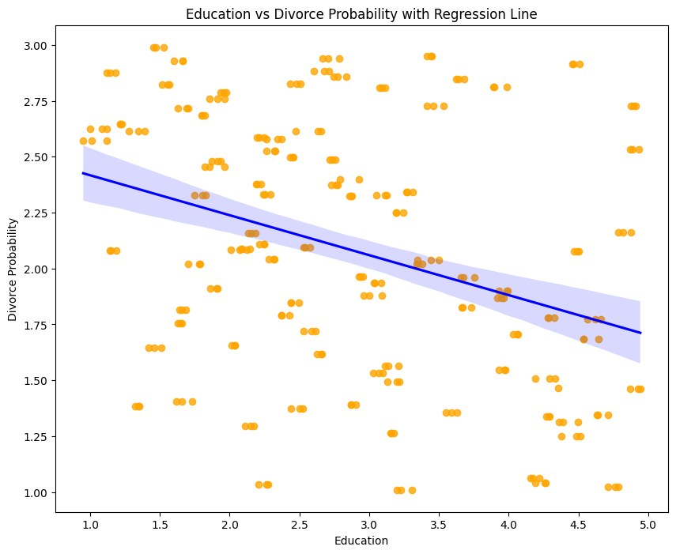
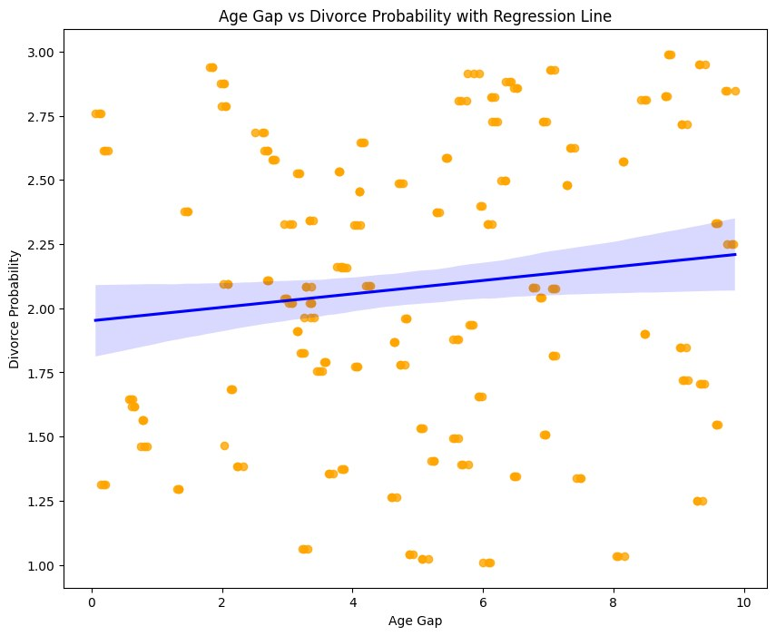

# Predictors of Marriage Stability: Preserving Baitul Muslim

Group project for CSCI 4343 Data Science, International Islamic University Malaysia (Semester II, 2024/2025).

Divorce is a rising social concern in Iran, and Baitul Muslim (the Muslim family institution) depends on counsellors and policymakers to support couples. This project analyses socio-demographic and relationship factors to find which ones are most linked to marriage stability, so that support can be better targeted.

## Data

The Marriage and Divorce dataset from Kaggle (`Marriage_Divorce_DB.csv`): 100 couples in Iran, 30 factors such as age gap, education, income, love, commitment and family relationships, and a divorce probability score. The dataset is not included here; download it from Kaggle and place it next to the notebook.

## Approach

1. **Clean and prepare:** checked data types and duplicates, ran IQR outlier checks on every factor, and expanded the small sample with Gaussian-noise augmentation (100 to 300 rows).
2. **Explore:** correlation matrix and regression plots to see how each factor relates to divorce probability.
3. **Model and tune:** a Support Vector Machine tuned with GridSearchCV (5-fold) over C (0.1, 1, 10), gamma (scale, auto) and three kernels.
4. **Recommend:** turned the findings into suggestions for counsellors, policymakers and Baitul Muslim institutions.

## Results

| Kernel | Train accuracy | Test accuracy |
|---|---|---|
| **Linear** | **0.711** | **0.667** |
| Polynomial | 0.706 | 0.667 |
| RBF | 0.658 | 0.649 |

The linear kernel generalised best, which suggests a linear boundary captures the relationship without the overfitting risk of more complex kernels.

  
  

**Key findings**

- Education had the strongest relationship with marriage stability (r = −0.34): higher education was linked to lower divorce probability.
- Age gap on its own showed only a weak positive link, so compatibility and shared values seem to matter more.

## What I would improve

- Collect a larger real sample instead of relying on augmentation, and keep augmented copies out of the test set.
- Report precision and recall alongside accuracy.

## Tech stack

Python, pandas, NumPy, scikit-learn, Matplotlib, seaborn, Jupyter

## My role

Group of five. I handled most of the data cleaning and preparation at the start of the project.
