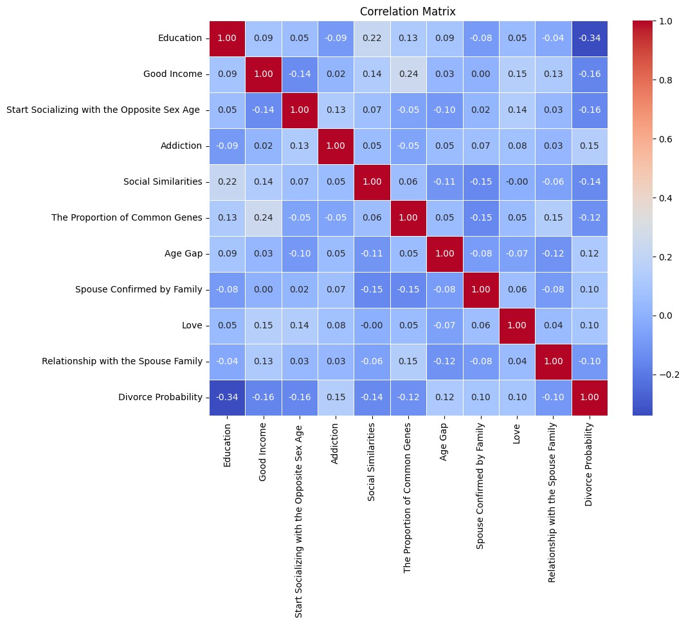

# Predictors of Marriage Stability: Preserving Baitul Muslim

Group project for CSCI 4343 Data Science, International Islamic University Malaysia (Semester II, 2024/2025).

Divorce is a rising social concern in Iran, and Baitul Muslim (the Muslim family institution) depends on counsellors and policymakers to support couples. This project analyses socio-demographic and relationship factors to find which ones are most linked to marriage stability, so that support can be better targeted. The work supports UN Sustainable Development Goal 16 (strong institutions and family stability).

## Data

The Marriage and Divorce dataset from Kaggle (`Marriage_Divorce_DB.csv`): 100 couples in Iran, 30 factors such as age gap, education, income, love, commitment and family relationships, and a divorce probability score. The dataset is not included here; download it from Kaggle and place it next to the notebook.

## Approach

1. **Clean and prepare:** checked data types, missing values and duplicates; ran IQR, z-score and Isolation Forest outlier checks; expanded the 100 couples to 300 rows with Gaussian-noise augmentation; Isolation Forest then removed 15 rows, leaving 285.
2. **Select features:** kept the 10 factors most correlated with divorce probability, including education, good income, social similarities, addiction, age gap, love and spouse confirmed by family.
3. **Explore:** correlation matrix and regression plots to see how each factor relates to divorce probability.
4. **Model:** split divorce probability (1–3) into a lower and a higher class, split the data 80/20 (228 / 57 rows), compared SVM kernels, then tuned with GridSearchCV (5-fold, 90 fits) over C (0.1, 1, 10), gamma (scale, auto) and linear, RBF and polynomial kernels.

## Results

| Model | Train accuracy | Test accuracy |
|---|---|---|
| Linear, default settings | 0.711 | 0.667 |
| Polynomial, default settings | 0.706 | 0.667 |
| RBF, default settings | 0.658 | 0.649 |
| **RBF tuned (C = 1, gamma = auto)** | – | **0.947** |

The tuned model reached precision 0.96 and recall 0.94 (macro average) on the 57 test rows.

  
  

**Key findings**

- Education had the strongest relationship with marriage stability (r = −0.34): higher education was linked to lower divorce probability.
- Age gap on its own showed only a weak positive link, so compatibility and shared values seem to matter more.
- Emotional and family factors such as love and family approval sat among the top predictors next to socio-economic ones, which fits the role of family involvement in marriage in Iran.

## What I would improve

- **The 94.7% is likely optimistic.** Augmentation ran before the train-test split, so noisy copies of the same couple can sit in both sets. Splitting first and augmenting only the training data would give a fairer score.
- The default-kernel models were trained on unscaled features; using the standardised features for every model would make the comparison fairer.
- Collect a larger, more recent sample, including Malaysian data where Baitul Muslim works differently.
- Try XGBoost or neural networks, and turn the model into a simple web tool that counsellors could use for premarital guidance.

## Notebook

`notebooks/marriage_stability_analysis.ipynb` was rebuilt from a printed export of the original notebook. A few lines cut off at the page edge were restored and are marked `# restored`.

## Tech stack

Python, pandas, NumPy, scikit-learn, Matplotlib, seaborn, Jupyter

## My role

Group of five. I handled most of the data cleaning and preparation at the start of the project.
